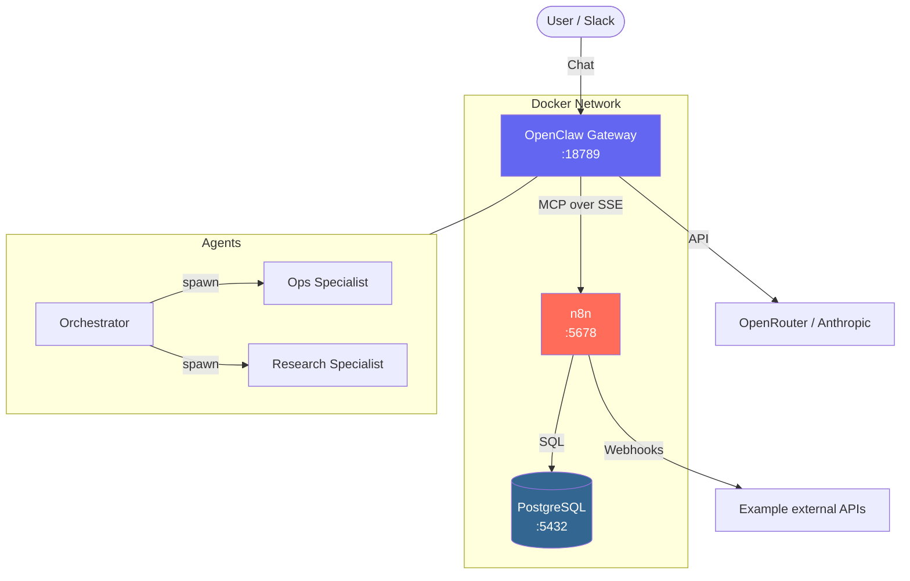

# openclaw-n8n-stack

[](LICENSE)
[](docker-compose.yml)

> Docker Compose example combining OpenClaw, n8n and PostgreSQL. Review configuration and security before using it in your environment.

---

## Architecture



**How it works:**
- **OpenClaw** receives user messages, routes them through a multi-agent system
- **n8n** can handle selected API calls and data lookups; total model usage depends on the request path
- **PostgreSQL** persists n8n workflows, credentials, and execution history
- A model can interpret requests; workflows can handle defined deterministic steps

---

## Quick Start

```bash
# 1. Clone
git clone https://github.com/lorenzespinosa/openclaw-n8n-stack.git
cd openclaw-n8n-stack

# 2. Configure
cp .env.example .env
# Edit .env — set POSTGRES_PASSWORD, N8N_ENCRYPTION_KEY,
# OPENCLAW_GATEWAY_TOKEN, and at least one AI provider key

# 3. Deploy
docker compose up -d

# 4. Verify
docker compose ps          # All 3 services should be "healthy"
curl http://localhost:5678/healthz    # n8n
curl http://localhost:18789/healthz   # OpenClaw
```

**Access points:**
| Service | URL | Purpose |
|---------|-----|---------|
| n8n | http://localhost:5678 | Workflow editor & webhook endpoints |
| OpenClaw | http://localhost:18789 | AI agent gateway & control UI |

### Import the bundled workflows (optional)

The `workflows/` directory ships six ready-made n8n workflows (see [Bundled Workflows](#bundled-workflows)). To load them into your running n8n instance:

```bash
# 1. Open n8n → Settings → API → Create API Key
# 2. Add it to .env:  N8N_API_KEY=your-key-here
# 3. Import
./scripts/init-workflows.sh
```

The script is **not idempotent** — running it twice creates duplicate workflows. After import, configure each workflow's credentials in the n8n UI and test with a sample payload before activating.

### Helper commands

A `Makefile` wraps the common `docker compose` operations:

```bash
make up        # start the stack
make ps        # service status
make health    # hit both health endpoints
make logs      # tail all logs
make import    # import bundled workflows
make down      # stop (keeps data)
make reset     # wipe volumes and start fresh
make help      # list everything
```

---

## Why route predictable tasks through workflows?

An API lookup or update can follow a defined workflow rather than being invented afresh for each request. A model may still be used upstream, and routing a step through n8n does not by itself prove cost savings. Measure the complete task, including retries, hosting and current vendor pricing.

---

## Configuration Reference

### Environment Variables (`.env`)

| Variable | Required | Default | Description |
|----------|----------|---------|-------------|
| `POSTGRES_PASSWORD` | Yes | -- | PostgreSQL password |
| `N8N_ENCRYPTION_KEY` | Yes | -- | Encrypts n8n credentials at rest |
| `N8N_BASIC_AUTH_PASSWORD` | Yes | -- | Password for the n8n editor login |
| `OPENCLAW_GATEWAY_TOKEN` | Yes | -- | Auth token for OpenClaw API |
| `OPENROUTER_API_KEY` | Yes* | -- | OpenRouter API key for AI models |
| `ANTHROPIC_API_KEY` | No | -- | Direct Anthropic API key (alternative to OpenRouter) |
| `POSTGRES_USER` | No | `n8n` | PostgreSQL username |
| `POSTGRES_DB` | No | `n8n` | PostgreSQL database name |
| `N8N_HOST` | No | `localhost` | n8n hostname |
| `N8N_PORT` | No | `5678` | n8n exposed port |
| `N8N_PROTOCOL` | No | `http` | `http` or `https` |
| `WEBHOOK_URL` | No | `http://localhost:5678/` | n8n webhook base URL |
| `N8N_MCP_SERVER_ENABLED` | No | `true` | Enable n8n MCP server |
| `N8N_BASIC_AUTH_ACTIVE` | No | `true` | Require login for the n8n editor |
| `N8N_BASIC_AUTH_USER` | No | `admin` | Username for the n8n editor login |
| `N8N_API_KEY` | No | -- | n8n API key — only needed to run `scripts/init-workflows.sh` |
| `OPENCLAW_PORT` | No | `18789` | OpenClaw exposed port |
| `SLACK_BOT_TOKEN` | No | -- | Slack bot token (optional) |
| `SLACK_APP_TOKEN` | No | -- | Slack app token for socket mode |
| `TZ` | No | `America/New_York` | Timezone |

*At least one AI provider key is required (OpenRouter or Anthropic).

---

## Identity Stack

The `workspace/` directory contains markdown files that define agent behavior:

| File | Purpose |
|------|---------|
| `SOUL.md` | Core identity, principles, and delegation rules |
| `AGENTS.md` | Agent routing instructions and delegation patterns |
| `USER.md` | User profiles and communication preferences |
| `TOOLS.md` | Available MCP tools, when to use n8n vs AI, cost estimates |

Edit these files to customize agent behavior for your use case.

---

## Agent Configuration

Three agents are pre-configured in `config/openclaw.json`:

### Orchestrator (default)
- **Model:** Claude Sonnet 4
- **Role:** Receives all messages, routes to specialists
- **Tools:** read, write, memory_search, sessions_spawn
- **System prompt:** Loaded from `workspace/SOUL.md`

### Ops Specialist
- **Model:** Claude Sonnet 4
- **Role:** Executes workflows via n8n MCP tools
- **Tools:** read, exec (allowlisted to `curl` only)
- **Use for:** API calls, data writes, webhook triggers

### Research Specialist
- **Model:** Claude 3.5 Haiku (fast, cheap)
- **Role:** Searches files, memory, and web
- **Tools:** read, memory_search, web_search, web_fetch
- **Use for:** Information retrieval, document Q&A

---

## Bundled Workflows

Six workflows ship in `workflows/`. The five `MCP:` workflows expose a webhook the agent calls instead of generating and parsing API requests itself; the health check runs on a schedule. Import them with `scripts/init-workflows.sh` (see [Quick Start](#import-the-bundled-workflows-optional)).

| Workflow | File | Trigger | Purpose |
|----------|------|---------|---------|
| CRM Contact Lookup | `crm-contact-lookup.json` | `POST /webhook/mcp/crm-lookup` | Fetch contact/client data |
| SMS Send (OpenPhone) | `sms-send-openphone.json` | `POST /webhook/mcp/sms-send` | Send SMS via OpenPhone |
| Airtable Staging Write | `airtable-staging-write.json` | `POST /webhook/mcp/staging-write` | Write records to Airtable staging |
| Calendar Availability Check | `calendar-availability-check.json` | `POST /webhook/mcp/calendar-check` | Check calendar availability |
| Audit Log Writer | `audit-log-writer.json` | `POST /webhook/mcp/audit-log` | Write an example audit record; review sensitive fields |
| Service Health Check | `service-health-check.json` | Schedule | Ping services, alert on failure |

The table shows default production URL paths for the committed Webhook nodes when n8n uses its default `/webhook` endpoint. Confirm the Production URL displayed by n8n after configuration; test URLs and custom endpoint settings can differ. Each workflow needs its own credentials configured before it will run.

> **Why route through n8n?** A deterministic API step can be tested separately from a model prompt. Whether that improves cost or reliability depends on the full design and current provider terms.

---

## Security assumptions to verify

- Review environment variables and committed files for secrets before use.
- Restrict gateway access, filesystem paths and tool permissions for your own deployment.
- Test the container user and read-only mounts rather than treating this example as a security guarantee.

---

## Troubleshooting

### Services won't start
```bash
# Check logs
docker compose logs postgres
docker compose logs n8n
docker compose logs openclaw-gateway

# Common fix: ensure .env exists and all required values are set
for var in POSTGRES_PASSWORD N8N_ENCRYPTION_KEY OPENCLAW_GATEWAY_TOKEN OPENROUTER_API_KEY; do
  grep -q "^${var}=.\+" .env 2>/dev/null && echo "SET: $var" || echo "MISSING: $var"
done
```

### n8n health check fails
```bash
# n8n needs PostgreSQL to be healthy first
docker compose logs postgres  # Check for auth errors
docker compose restart n8n
```

### OpenClaw can't reach n8n MCP
```bash
# Verify n8n MCP is enabled
docker compose exec n8n wget -qO- http://localhost:5678/mcp

# Check the Docker network
docker compose exec openclaw-gateway wget -qO- http://n8n:5678/healthz
```

### Permission denied on volumes
```bash
# OpenClaw runs as UID 1000 — ensure workspace is writable
sudo chown -R 1000:1000 workspace/
```

### Reset everything
```bash
docker compose down -v   # Removes containers AND volumes
docker compose up -d     # Fresh start
```

---

## Related Projects

- [OpenClaw](https://github.com/openclaw/openclaw) -- AI agent gateway
- [n8n](https://github.com/n8n-io/n8n) -- Workflow automation
- [n8n MCP Documentation](https://docs.n8n.io/integrations/mcp/) -- MCP server setup

---

## License

[MIT](LICENSE) -- Copyright (c) 2025 Lorenz Espinosa

---

<!-- hire-cta -->
## About Lorenz

I'm Lorenz Espinosa, an IT systems and automation consultant. This repository is public example material, not a record of client systems or results.

For a general inquiry, please leave out client names, records and confidential details: [Email](mailto:renzespinosa13@gmail.com) · [Portfolio](https://lorenzespinosa.github.io/) · [LinkedIn](https://www.linkedin.com/in/lorenz-leslie-espinosa/).
